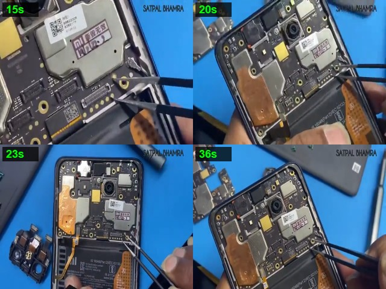
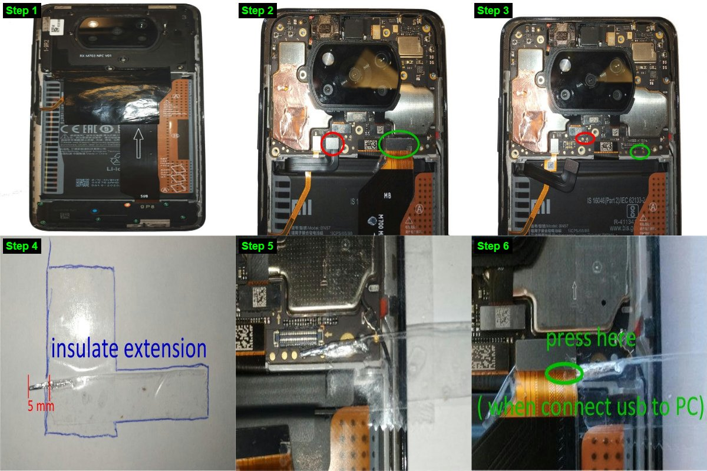

<div align="center">

<br>

# POCO X3 Pro EDL Bootloader Unlocker

**EDL 9008. Unlocked. Verified.**

<br>

[](#)
[](../../releases)
[-6C5CE7?style=for-the-badge)](POCO_X3_Pro_Bootloader_Unlock_Guide.pdf)

`POCO X3 Pro` · `vayu` · `bhima` · `EDL 9008` · `Windows 10/11`

<br>

</div>

Short the two EDL points. Plug in USB. Your bootloader is unlocked in two
seconds.

Built for POCO X3 Pro (`vayu` and `bhima`) boards where official Mi Unlock
refuses with `20091` or `20031` after a CPU reball or `SM8150` replacement.

<br>

## It tells you if it worked

Most EDL scripts fire `fh_loader` blindly and reboot. If the sector shifted or
the write dropped, you only find out after reassembling the phone.

This tool reads your live `devinfo` partition from UFS LUN `0`, saves a
timestamped backup to `backups/`, patches only the unlock flags so board and
display bytes stay untouched, writes it back, and reads the partition back from
flash to compare every byte before resetting the device.

```
[+] Backed up original devinfo -> backup_devinfo_20261026_031502.bin (unlocked=0, critical=0)
[+] VERIFIED 100% BYTE-FOR-BYTE: UFS LUN 0 sector 12288 now contains
    magic=b'ANDROID-BOOT!', is_unlocked=1, is_unlock_critical=1!
[+] SUCCESS! Phone is rebooting (UNLOCKED bootloader state).
```

<br>

## Use

```
1  Download or clone this repository on Windows 10/11
2  Double-click One_Click_Unlock_POCO_X3_Pro.bat (installs drivers & arms auto-unlock)
3  Unplug battery ribbon · keep the wide MB ribbon plugged in
4  Bridge the two gold EDL points on the right edge of MB · plug in USB-C
```

> **First boot on Android 12+:** Qualcomm Keymaster (`km41`) binds `/data`
> encryption to `device_locked`. If the phone boots into Xiaomi Recovery after
> unlocking, select **Wipe Data → Wipe All Data** once, then reboot.

**Want to relock later?** Open `Run_Unlocker_GUI.bat`, click **Restore / Relock
devinfo Backup**, and select your original `.bin` from `backups/` (or
`backups/stock_vayu_locked_devinfo.bin`).

<br>

## Test points

<div align="center">
  
</div>

<br>

- **Point 1 (top tweezer tip):** Single gold dot just above the right corner of
  the wide `MB` connector, right under the silver shield corner.
- **Point 2 (bottom tweezer tip):** The 5th (rightmost) gold dot in the row of
  5 dots directly below the `MB` connector.

> **Keep the wide black `MB` ribbon plugged in.** Frame `15s` above shows the
> `MB` cable lifted only so the camera can see the two gold dots clearly. The
> `MB` ribbon carries the USB-C data lines from the charging board to the
> motherboard — leave it plugged in (frames `20s` and `36s`) while bridging the
> two points.

<div align="center">
  
</div>

<br>

## Entry points

| | | |
|:--|:--|:--|
| `One_Click_Unlock_POCO_X3_Pro.bat` | GUI + `--auto-start` | Installs 9008/Fastboot drivers and arms auto-unlock immediately |
| `Run_Unlocker_GUI.bat` | GUI | Opens the dark-mode interface for manual unlock, PDF guide, or backup restore |
| `Run_Auto_Unlock_CLI.bat` | CLI (`--cli --wait`) | Terminal runner that polls for `9008` and unlocks automatically |
| `Install_Drivers.bat` | Admin installer | Installs signed Qualcomm `qcser.inf` (`9008`) and Fastboot WinUSB drivers |

<br>

## Under the hood

**Why Mi Unlock fails with 20091.** Reballed or replacement `SM8150` chips ship
unfused (`secure: no` in `fastboot getvar all`) without a factory FID key in
Qualcomm TEE (`cardapp`). When *Settings → Mi Unlock Status* tries to bind your
account, `cardapp` returns `Error 41`, Xiaomi's server answers `code 10012 (No
available key on server)`, and `Settings.apk` maps that to `20091`.

**Why EDL 9008 needs no Xiaomi auth on `secure: no`.** Disassembly of the stock
`vayu` Firehose programmer (`prog_ufs_firehose_sm7150_ddr.elf` at `0x14839868
-> 0x1483d904`) shows that Xiaomi's `<sig>` check calls
`boot_is_auth_enabled()`. When `secure: no`, it returns `0` and skips signature
verification. At boot, `abl.elf` (`ReadWriteDeviceInfo` at `0x2b4e4`) sees
`IsSecureBootEnabled() == 0`, skips `oem_misc1`, and reads `is_unlocked`
(`0x0D = 1`) and `is_unlock_critical` (`0x0E = 1`) straight from `devinfo`.

**Can't brick you.** Only the 4 KB `devinfo` partition on UFS LUN `0` is
touched (`xbl`, `abl`, `tz`, `modem`, and `persist` are never written). Before
writing, the live partition is backed up to `backups/`. If a custom GPT moved
`devinfo` off sector `12288`, the tool parses LUN `0` primary GPT on the fly to
find the exact LBA before touching flash.

<br>

## Something off?

| Symptom | Fix |
|:--|:--|
| Nothing happens when bridging the two points | Keep the wide black `MB` ribbon **plugged in**; only unplug the battery ribbon |
| Unknown device `QUSB_BULK_CID` in Device Manager | Run `Install_Drivers.bat` as Administrator |
| Sahara upload fails on second run | Unplug USB, disconnect battery for 3s, short the two points and reconnect (`9008` accepts one Sahara upload per boot) |
| Charging icon with red bar after reset | Unplug USB, press the battery connector down until it clicks, hold Power for 5s |
| Boots into Xiaomi Recovery after unlock | Select **Wipe Data → Wipe All Data** once (`km41` requires a fresh `/data` key on state change) |
| Xiaomi Account email 2FA says *"Too many attempts, try again tomorrow"* | Log in at `account.xiaomi.com` on a browser where your account is already signed in, change the account email to a secondary address (which resets the 2FA counter immediately), verify with the new email code, and remove the Xiaomi account |

<br>

<details>
<summary><b>Flow</b></summary>

<br>

```
stage 1  winreg SERIALCOMM + lsusb        detect VID_05C6&PID_9008 (COMx) in <1 ms
stage 2  QSaharaServer / 64-bit Sahara    upload prog_ufs_firehose_sm7150_ddr.elf
stage 3  fh_loader read_devinfo.xml       read UFS LUN 0 sector 12288 -> backups/
stage 4  patch_existing_devinfo           set 0x0D=1, 0x0E=1, 0x0F=0, 0x90=1, 0x8A0=1
stage 5  fh_loader write + verify         flash devinfo_unlocked.img & compare 4096/4096 bytes
stage 6  fh_loader --reset                reboot into unlocked bootloader
```

</details>

<br>

---

<div align="center">
<sub>

**Mohammad Mehrab Hossain** · [`0xmehr4b`](https://github.com/0xmehr4b)

[Guide (PDF)](POCO_X3_Pro_Bootloader_Unlock_Guide.pdf) · [Changelog](CHANGELOG.md) · [Credits](CREDITS.md) · [Licence](LICENSE)

</sub>
</div>
